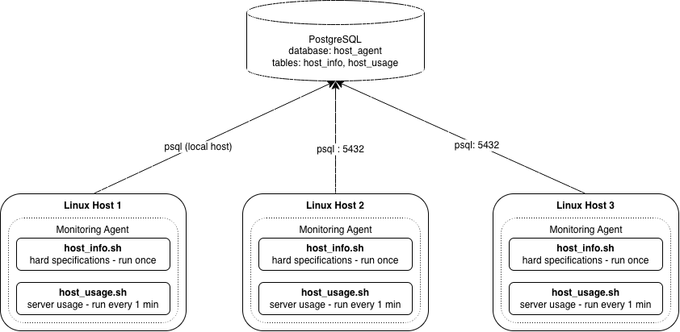

# Linux Cluster Monitoring Agent
## Introduction

This project is a monitoring agent for a cluster of Linux servers. This program will be installed on each of the servers to gather both hardware specifications and resource usage data and then persist that data into a PostgreSQL instance. Each host runs two bash scripts: 
- host_info.sh: Records the machine's hardware specifications once.

- host_usage.sh: Captures server usage data. It is triggered by cron every minute.

All data is stored in a PostgreSQL database running in Docker so the infrastructure team can track resource usage across every node from one place.

System administrators use this project to check and plan capacity and detect overloaded servers.

Tech stack: Bash, Docker, PostgreSQL, cron, and Git/GitHub with feature branches for version control.

## Quick Start

Run these commands from the `linux_sql` directory. Replace the example credentials with your own:

```bash
# Create and start the PostgreSQL container and persistent volume
./scripts/psql_docker.sh create postgres <db_password>

# Create the database and its tables
psql -h localhost -p 5432 -U postgres -c "CREATE DATABASE host_agent;"
psql -h localhost -p 5432 -U postgres -d host_agent -f sql/ddl.sql

# Register this machine's hardware details
./scripts/host_info.sh localhost 5432 host_agent postgres <db_password>

# Record one usage snapshot
./scripts/host_usage.sh localhost 5432 host_agent postgres <db_password>
```

To collect usage every minute, open your crontab with `crontab -e` and add a line like this. Update the path and credentials for your environment:

```cron
* * * * * bash /path/to/linux_sql/scripts/host_usage.sh localhost 5432 host_agent postgres <db_password> >> /tmp/host_usage.log 2>&1
```

## Implementation
I built the project in small steps, each on its own feature branch (feature/psql_docker, feature/rdbms_ddl, feature/monitoring_agent), and then merged into develop when it was done.

## Architecture



### Scripts

**`psql_docker.sh`** creates, starts, or stops the `jrvs-psql` PostgreSQL container. The `create` command also creates the `pgdata` volume.

```bash
./scripts/psql_docker.sh create <db_username> <db_password>   # create container + volume
./scripts/psql_docker.sh start                                # start existing container
./scripts/psql_docker.sh stop                                 # stop container
```

**`host_info.sh`** reads CPU details from `lscpu`, memory details from `vmstat`, and the fully qualified hostname. It inserts a row into `host_info`. Because each hostname must be unique, the same machine cannot be registered twice without first updating or removing its existing row.

```bash
./scripts/host_info.sh <psql_host> <psql_port> <db_name> <psql_user> <psql_password>
```
 
**`host_usage.sh`**: takes one `vmstat` snapshot (in MB) so that all values come from the same moment. The host's ID is resolved inside the `INSERT` with a subquery on `hostname`, so the script never needs to know the numeric ID.
```bash
./scripts/host_usage.sh <psql_host> <psql_port> <db_name> <psql_user> <psql_password>
```

**crontab**: runs `host_usage.sh` once a minute and add output to a log file.
```bash
* * * * * bash /path/to/linux_sql/scripts/host_usage.sh localhost 5432 host_agent postgres password >> /tmp/host_usage.log 2>&1
```

## Database Modeling

`host_info` stores one hardware profile per machine:

| Column | Type | Description |
|---|---|---|
| `id` | SERIAL, primary key | Generated host ID |
| `hostname` | VARCHAR, unique | Fully qualified hostname |
| `cpu_number` | INT2 | Number of CPUs |
| `cpu_architecture` | VARCHAR | CPU architecture, such as `x86_64` |
| `cpu_model` | VARCHAR | CPU model |
| `cpu_mhz` | FLOAT8 | CPU clock speed in MHz |
| `l2_cache` | INT4 | L2 cache size in kB |
| `timestamp` | TIMESTAMP | Collection time (UTC) |
| `total_mem` | INT4 | Total memory in kB |

`host_usage` stores resource snapshots associated with a registered host:

| Column | Type | Description |
|---|---|---|
| `timestamp` | TIMESTAMP | Snapshot time (UTC) |
| `host_id` | SERIAL, foreign key | References `host_info.id` |
| `memory_free` | INT4 | Free memory in MB |
| `cpu_idle` | INT2 | CPU idle time (%) |
| `cpu_kernel` | INT2 | CPU time in kernel mode (%) |
| `disk_io` | INT4 | Disk I/O operations in progress |
| `disk_available` | INT4 | Available space on the root filesystem in MB |

## Test
Each feature was tested manually on a Rocky Linux VM:
- **DDL:** ran `ddl.sql` against `host_agent` and confirmed both tables with `SELECT * FROM host_info (host_usage)`. Inserted sample rows to verify constraints.
- **`host_info.sh`:** returned `INSERT 0 1`, and the row matched `lscpu` output. A second run was correctly rejected by the unique constraint on `hostname`. Testing also showed that sample rows inserted with hard-coded IDs had left the ID sequence behind; resetting it with `setval` fixed that.
- **`host_usage.sh`:** before the host was registered, the insert failed on the `NOT NULL` `host_id`, which confirmed the subquery link works as intended. After registration, it returned `INSERT 0 1`.
- **Cron:** checked `/tmp/host_usage.log` per minute and confirmed new rows in `host_usage`.
- **Debugging:** used `bash -x` to trace variable values and print the final SQL before it was sent.

## Deployment
- **Docker** hosts PSQL in an isolated container, with a named volume so data persists across restarts.
- **Cron** runs the usage agent every minute.
- **GitHub** stores the source. Each feature was developed on its own `feature/*` branch and merged into `develop`, with `main` reserved for releases (will be reviewed by Senior Technical Instructor).

## Improvements
- **Handle hardware changes:** `host_info.sh` currently refuses to run twice. It could upsert (`ON CONFLICT ... DO UPDATE`) so that added RAM or CPUs are reflected automatically.
- **Portability:** column positions in `vmstat` differ between versions, so parsing by header name instead of fixed column number would make the agent safer across distributions.
